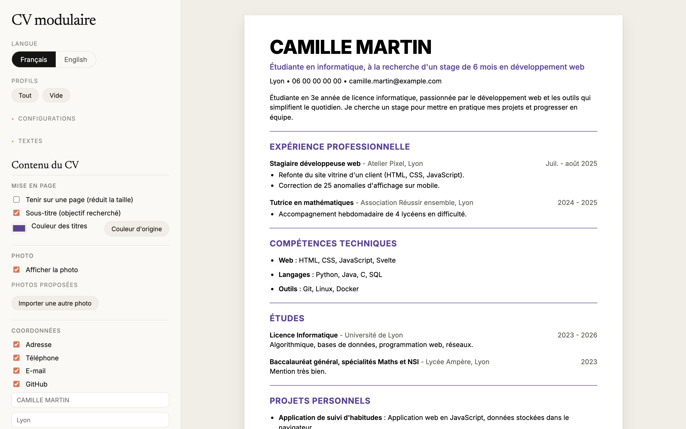

# CV modulaire

Application web pour composer un CV sur mesure : on coche les éléments à afficher, on choisit la langue (français / anglais), et on exporte le résultat en PDF au format A4.

Aucun serveur, aucune dépendance : c'est du HTML, du CSS et du JavaScript pur.

**[Essayer la démo en ligne](https://hugollbs.github.io/CVModulator/)** (le CV affiché est un exemple fictif)

Version anglaise : [aperçu](docs/apercu-en.png).

## Utilisation

1. Ouvrir `index.html` dans un navigateur (double-clic, ou `python3 -m http.server` puis http://localhost:8000).
2. Ajouter son contenu avec les boutons « + Ajouter » (expériences, études, compétences, langues…). Les textes se modifient en cliquant dessus.
3. Cocher / décocher les éléments, choisir la langue, importer une photo.
4. Cliquer sur « Exporter en PDF », puis choisir « Enregistrer au format PDF » dans la fenêtre d'impression (désactiver les en-têtes et pieds de page).

## Fonctionnalités

- Contenu bilingue (chaque texte existe en français et en anglais).
- Profils et configurations nommées : une configuration mémorise la sélection actuelle (cases cochées, langue, niveaux de langue, photo, présentation).
- Sauvegarde automatique dans le navigateur, export / import en JSON.
- Aperçu A4 en direct.

## Confidentialité

Tes données restent dans ton navigateur (`localStorage`). Elles ne sont envoyées nulle part. Seules les polices Google Fonts sont chargées depuis Internet.
Le dépôt ne contient aucune donnée personnelle : `data.js` contient un CV d'exemple entièrement fictif (Camille Martin), à remplacer par le tien. Pense à utiliser l'export JSON pour sauvegarder ton CV, car vider les données du navigateur l'efface.

## Licence

Utilisation libre, modification et redistribution interdites sans accord de l'auteur. Voir [LICENSE](LICENSE).

## Structure

| Fichier | Rôle |
|---|---|
| `index.html` | Structure de la page (panneau de contrôle + aperçu) |
| `style.css` | Mise en forme de l'interface et du CV imprimé |
| `data.js` | CV d'exemple fictif, libellés, profils prédéfinis |
| `app.js` | Logique : rendu, édition, sauvegarde, configurations, export |
